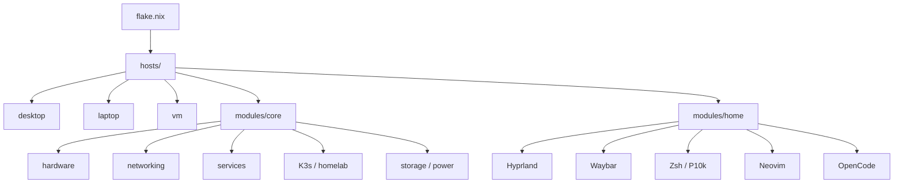
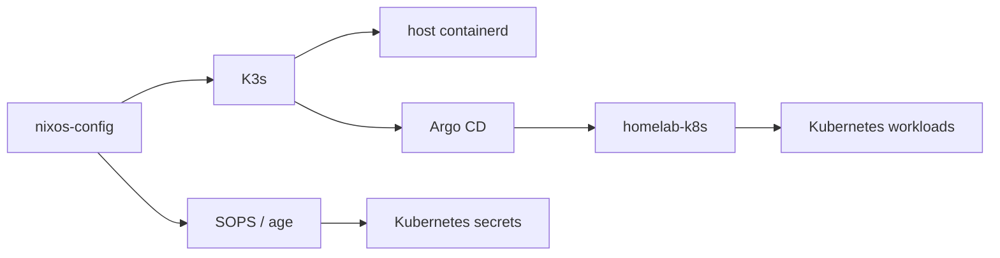

# NixOS Configuration

Personal NixOS configuration for my **desktop, laptop and VM**.

The project started from [Frost-Phoenix's configuration](https://github.com/Frost-Phoenix/nixos-config), which helped me a lot while I was getting into NixOS. Since then, it has grown into my own modular **workstation + homelab** setup.



## Highlights

| Area               | What's here                                                   |
| :----------------- | :------------------------------------------------------------ |
| **OS**             | NixOS + Flakes + `nixos-unstable`                             |
| **Hosts**          | Desktop, laptop, KVM/QEMU VM                                  |
| **Desktop**        | Hyprland, Waybar, SwayNC, Rofi, Hyprlock                      |
| **Shell**          | Zsh, Powerlevel10k, custom aliases and scripts                |
| **Editor**         | Neovim via `nvf`                                              |
| **Gaming**         | Steam, Gamescope, Proton-GE, RetroArch                        |
| **GPU**            | NVIDIA + Intel, PRIME offload, NVIDIA Container Toolkit       |
| **Audio**          | PipeWire, WirePlumber, Bluetooth / LDAC                       |
| **Networking**     | NetworkManager, Tailscale, OpenSSH, Mosh, Clash Verge         |
| **Virtualization** | Docker, Podman, libvirt/QEMU, SPICE                           |
| **Secrets**        | SOPS + age                                                    |
| **AI tooling**     | OpenCode + OpenRouter                                         |
| **Homelab**        | K3s, containerd, Argo CD                                      |
| **Maintenance**    | Nix GC, store optimization, container pruning, journal limits |

## Architecture

The configuration is split into three layers:

```text
flake.nix
│
├── hosts/
│   ├── desktop/
│   ├── laptop/
│   └── vm/
│
├── modules/core/
│   ├── system
│   ├── hardware
│   ├── networking
│   ├── services
│   ├── virtualization
│   ├── storage / power
│   └── homeLab
│
└── modules/home/
    ├── Hyprland
    ├── Waybar
    ├── Zsh / Powerlevel10k
    ├── Neovim
    ├── applications
    ├── scripts
    └── AI tooling
```

`modules/core` contains the shared system configuration. `modules/home` contains the user environment. `hosts/*` only adds the parts that actually differ between machines.

The flake currently defines three NixOS configurations: `desktop`, `laptop` and `vm`.

## Hosts

| Host      | Purpose              | Main differences                                |
| :-------- | :------------------- | :---------------------------------------------- |
| `desktop` | Main workstation     | CachyOS kernel, performance-oriented CPU policy |
| `laptop`  | Mobile workstation   | Power tuning, undervolt, battery protection     |
| `vm`      | KVM/QEMU environment | Latest kernel, GRUB, SSH                        |

Most of the setup is shared. Host-specific files are mainly used for hardware, boot and power settings.

## Desktop

The desktop is built around **Hyprland + Wayland** with a Gruvbox-oriented look.

### Hyprland

The configuration includes:

* `dwindle` layout with minimal window decorations.
* Custom blur, shadow and workspace behavior.
* Wayland/XWayland support.
* Screenshot, clipboard and application-launcher workflows.
* Custom session startup for Waybar, SwayNC and other utilities.
* Power-profile and wallpaper controls through keybinds.

### Waybar

Waybar is split into declarative settings and styling modules.

It includes:

* Hyprland workspaces.
* Keyboard layout and system tray.
* Active window title and clock.
* CPU, memory and disk usage.
* Battery and audio status.
* Notifications.
* Weather with a three-day tooltip forecast.
* Cava audio visualization.

### Shell

The shell setup uses **Zsh + Powerlevel10k** with a large set of context-aware prompt segments.

The prompt can expose things such as:

* Git status.
* Command duration / exit status.
* Python, Node, Rust and Go environments.
* Docker and Kubernetes context.
* Nix shell state.
* Different terminal-shell integrations.

There are also custom shell aliases, keybindings and scripts for everyday desktop tasks.

### Neovim

Neovim is configured declaratively through [`nvf`](https://github.com/NotAShelf/nvf).

The setup includes:

* Gruvbox dark theme.
* Lualine and Telescope.
* `nvim-cmp`, LuaSnip and autopairs.
* Treesitter.
* LSP with format-on-save.
* `nvim-dap` and debugging UI.
* Neo-tree and Git integration.
* WhichKey.
* Yazi integration.
* Telescope Zoxide integration.
* CodeCompanion with Anthropic adapters.
* Language support for Bash, TypeScript, HTML, CSS, Python, Rust, Nix and Lua.

## Core System

### Hardware

The shared hardware layer provides:

* NVIDIA drivers with open kernel modules.
* PRIME render offload.
* Intel graphics acceleration.
* NVIDIA Container Toolkit.
* Bluetooth + Blueman.
* Firmware and Intel microcode support.

The desktop and laptop can additionally use the CachyOS kernel packages from the `chaotic` input.

### Networking

The networking layer includes:

* NetworkManager.
* Explicit DNS resolvers.
* Stateful firewall configuration.
* Tailscale.
* OpenSSH.
* Mosh.
* Clash Verge in service / TUN mode.
* Local network service ports such as LocalSend.

### Audio

PipeWire replaces PulseAudio and is configured with:

* ALSA + 32-bit ALSA support.
* Pulse compatibility.
* WirePlumber.
* Bluetooth enhancements.
* LDAC as the preferred Bluetooth codec.
* Multiple allowed sample rates from `44.1` to `192 kHz`.
* High-quality Speex resampling.

### Virtualization

The shared virtualization layer provides:

* Docker with rootless mode.
* Podman.
* libvirt/QEMU.
* `virt-manager` and `virt-viewer`.
* SPICE / USB redirection.
* Windows virtio and SPICE packages.

## Development Environment

Development tools are part of the same declarative setup rather than a separate machine bootstrap.

Some of the main tools are:

* `git` and `lazygit`.
* `ripgrep`, `fd`, `fzf`, `eza`.
* `direnv` / `nix-direnv`.
* `devenv`.
* Python and IPython.
* `repomix` for packaging repository context for AI tooling.
* `alejandra` for Nix formatting.
* `nix-ld` for applications that expect a more conventional runtime environment.

## AI Tooling

AI-assisted development is integrated into the user configuration.

### OpenCode

OpenCode is managed through a dedicated Home Manager module.

The wrapper:

1. Reads the OpenRouter API key from the SOPS-provisioned runtime secret.
2. Points OpenCode at the local AI workspace.
3. Exposes the Nix-selected Python interpreter through `AI_WORKSPACE_PYTHON`.
4. Starts the packaged OpenCode binary.

The same module also provides:

```text
workspace
workspace-validate
workspace-test
```

These wrappers expose the local AI workspace and its validation/test workflow without relying on an ad-hoc system-wide Python setup.

A user-level systemd service can also run the OpenCode Web UI on localhost port `4096`.

### Aider

Aider support is kept in the repository as optional configuration. It is currently disabled in the default Home Manager imports.

## Homelab

The NixOS configuration is also the **system layer** for the homelab.



K3s uses the NixOS-managed containerd socket. The configuration also aligns the K3s/containerd CNI paths and configures the NVIDIA runtime through the NVIDIA Container Toolkit.

The Kubernetes manifests themselves live in the separate [`homelab-k8s`](../homelab-k8s) repository.

### K3s

K3s is configured as a server with:

* External NixOS-managed containerd.
* Explicit CNI path configuration.
* NVIDIA container runtime support.
* Kubelet storage-pressure and image-GC policies.
* SSD-aware image pulling.
* Graceful K3s shutdown handling.
* Argo CD bootstrap.
* Declarative Kubernetes secret provisioning.

The switch from K3s's embedded containerd to the host-managed containerd is particularly useful for the NVIDIA runtime integration.

### Homelab Storage

The storage hierarchy is created declaratively from the NixOS side.

```text
~/homelab/
├── config/
└── data/
    ├── media/
    ├── music/
    ├── photos/
    ├── torrents/
    └── ...
```

Kubernetes workloads then mount the host paths they need.

## Secrets

Secrets are managed with **SOPS + age** rather than plaintext values.

```text
.sops.yaml
      │
      ▼
modules/core/homeLab/secrets.yaml
      │
      ├── NixOS services
      ├── K3s / Kubernetes secrets
      └── OpenCode runtime secrets
```

The K3s module declares the required secrets and renders them into a Kubernetes Secret template.

OpenCode uses the same secret flow for its OpenRouter API key.

## Reliability & Maintenance

### Storage maintenance

The system automatically handles several cleanup tasks:

* Weekly Nix garbage collection.
* Nix generations older than 14 days are removed by the configured GC policy.
* Automatic Nix store optimization through hardlinks.
* `/tmp` cleanup on boot.
* Weekly Docker pruning.
* Weekly Podman pruning.
* Systemd journal limited to `1 GB` and one month of retention.

### Battery protection

The laptop setup includes a dedicated systemd watchdog in addition to normal UPower policy.

| Condition             | Behavior                           |
| :-------------------- | :--------------------------------- |
| `30%`                 | Low battery                        |
| `25%`                 | Critical battery                   |
| `20% or less`         | Emergency watchdog starts tracking |
| `20% or less for 60s` | Power off                          |
| `5% or less`          | Immediate power off                |

The watchdog checks the kernel battery interface and verifies whether external power is present before acting.

## Repository Layout

```text
.
├── hosts/
│   ├── desktop/
│   ├── laptop/
│   └── vm/
│
├── modules/
│   ├── core/
│   │   ├── homeLab/
│   │   ├── windows/
│   │   ├── battery-shutdown.nix
│   │   ├── bootloader.nix
│   │   ├── hardware.nix
│   │   ├── network.nix
│   │   ├── nh.nix
│   │   ├── pipewire.nix
│   │   ├── program.nix
│   │   ├── security.nix
│   │   ├── services.nix
│   │   ├── steam.nix
│   │   ├── storage-optimization.nix
│   │   ├── system.nix
│   │   ├── user.nix
│   │   ├── virtualization.nix
│   │   ├── wayland.nix
│   │   └── xserver.nix
│   │
│   └── home/
│       ├── hyprland/
│       ├── opencode/
│       ├── p10k/
│       ├── scripts/
│       ├── swaync/
│       ├── waybar/
│       ├── zsh/
│       └── application modules...
│
├── pkgs/
│   ├── 2048/
│   └── monolisa/
│
├── wallpapers/
│
├── .sops.yaml
├── flake.nix
├── flake.lock
├── install.sh
├── LICENSE
└── README.md
```

## Acknowledgements

Big thanks to **[Frost-Phoenix](https://github.com/Frost-Phoenix)** for the original configuration this project grew from and for helping me get comfortable with NixOS in the early stages.

The initial snapshot was explicitly based on his configuration; the later hardware setup, desktop environment, AI tooling, homelab integration and other system changes are my own evolution of that base.

## License

[MIT](./LICENSE)

